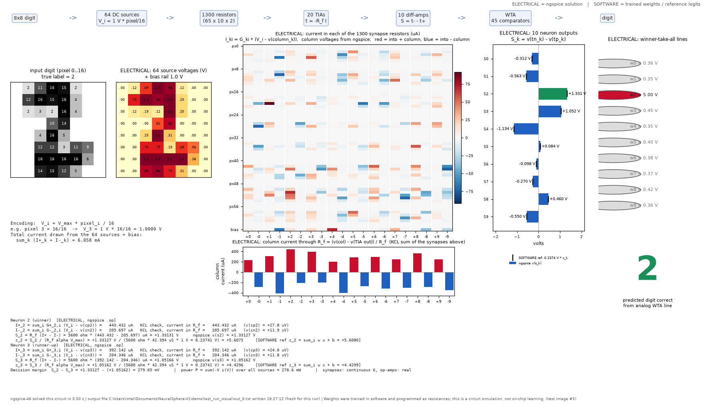

# NeuralSphere-V1: an analog resistive-crossbar neural network, simulated in SPICE

A 64-input, 10-output **differential resistive crossbar** with op-amp transimpedance neurons. It classifies the 8×8 handwritten digits from `sklearn.datasets.load_digits`. Every circuit result here is a voltage that **ngspice** solved for the full netlist: 1300 synapse resistors and 30 op-amps.



> **What this is:** a circuit **simulation**. It is not a fabricated chip or a breadboard.
> **What this is not:** on-chip or autonomous learning. The weights are trained **in software** and programmed into the netlist as resistances. The circuit performs the inference (the forward pass). "Stage E" fine-tuning feeds simulated circuit outputs back into a **software** gradient step (chip-in-the-loop).

## How it works

```
pixel/16 ──► 64 voltage sources ──► 1300 resistors (G+ / G- pairs) ──► 20 TIAs ──► 10 difference amps ──► S_0..S_9 ──► argmax or analog WTA
```

- Each signed weight is a conductance pair: G± = G_min + α·max(±w, 0), with α = 99 µS / 2.3352 = 42.39 µS per unit weight.
- The TIAs hold each column at virtual ground, so by Ohm's law and Kirchhoff's current law I_k = Σᵢ Gₖᵢ·Vᵢ.
- Each output is S_k = R_f·(I⁺_k − I⁻_k) = R_f·α·V_max·z_k = 5.6 kΩ × 42.39 µS × 1 V × z_k = **0.2374 V per logit**.

Every design decision is derived with substituted numbers in **[docs/DESIGN.md](docs/DESIGN.md)**.

## Results (360 held-out test images)

**Software (training, not a circuit result):**

| | Test accuracy | Source |
|---|---|---|
| sklearn LogisticRegression C=1 (baseline) | 344/360 = 95.56 % | `results/s02_software_reference.json` |
| Softmax regression, trained here | 348/360 = 96.67 % | same |

**Electrical (ngspice simulation of the circuit):**

| Circuit | Test accuracy | Source |
|---|---|---|
| Ideal op-amps | **348/360**, 0 disagreements with software | `results/s03_stageBC_verification.json` |
| Generic op-amp macromodel (A_OL 100 dB, GBW 1 MHz, rails, offset) | **348/360** | `results/s04_stageD_inference.json` |
| Generic macromodel + 8-bit conductances | 348/360 | same |
| + analog winner-take-all (45 comparators, 90 diodes) | 348/360, 0 ambiguous | `results/s08_wta.json` |
| **Texas Instruments OPA196 vendor model** | **348/360**, 0 disagreements; 75.0 mW vs 183.0 mW | `results/s12_opa196_stageD.json` |
| Harsh simulated chip (2-bit, 20 % mismatch, 20 mV offsets), after chip-in-the-loop fine-tuning | 342 → 346 /360 | `results/s05_stageE_in_loop.json` |

**Further electrical results:**
- **Noise** (`.noise` with the OPA196 model; `results/s13_noise.json`, `plots/fig11_noise.png`).
  - Hand calculation and ngspice agree at 1 kHz within 0.01 %, both 139.8 nV/√Hz for S_0.
  - With a 1 MHz readout filter, σ(S_k) = 291–302 µV.
  - The smallest decision margin, 4.56 mV, is 10.8 σ, so P_err ≈ 2·10⁻²⁷. Noise does not cause any of the 12 errors.
- **Transient, generic model** (`results/s07_transient_energy.json`): output settles within ~5 µs; 3.55–3.72 µJ per 20 µs image period at 182 mW. This excludes DACs, ADCs and programming circuitry.
- **Robustness:** quantization, tolerance, offset and supply sweeps are in `results/s06_*` and `plots/fig6_robustness.png`.

## Repository layout

```
src/ns/              Python package: config, netlist generation + ngspice runner (spice.py), weight→conductance mapping, metrics
scripts/             s00…s13 pipeline stages, figure script, run comparison and demo verification
circuits/models/     op-amp/comparator/diode models and the OPA196 pin-order wrapper
circuits/generated/  netlists written by the pipeline (one example per stage)
circuits/qucs/       Qucs-S schematic of one neuron and its netlists
demo/                interactive Tk demos (live ngspice per selection; 8×8 drawing pad)
data/, weights/      dataset split and trained weights / programmed conductances
results/, plots/     every number and figure quoted in the docs
docs/DESIGN.md       physics, formulas and worked examples
HANDOFF.md           full status, problems, and next steps
archive/             read-only reference copy of the original Linux/ngspice-47 run (SHA-256 manifest)
logs/                Windows validation logs (Linux vs Windows comparison report)
tools/               setup scripts; tools/get_opa196_model.ps1 fetches the TI model
```

## Quick start (Windows)

```powershell
git clone https://github.com/rachidlaad/NeuralSphere-V1.git
cd NeuralSphere-V1
powershell -ExecutionPolicy Bypass -File .\run_all.ps1 -Quick       # ~7 min
.\.venv\Scripts\python.exe demo\neuralsphere_visual.py              # visual demo
```

**Requirements:**
- Python 3.10+. `run_all.ps1` creates `.venv` from `requirements.txt`.
- ngspice, found under `tools\` or through the `NGSPICE` environment variable. Either:
  - the Qucs-S portable build from https://ra3xdh.github.io/, unpacked to `tools\qucs-s` (it bundles `ngspice_con.exe`), or
  - ngspice from https://ngspice.sourceforge.io/, unpacked to `tools\ngspice`.

**The OPA196 stages (s12, s13)** need TI's macromodel. It is copyrighted and therefore **not included**. Fetch the exact version used here, with SHA-256 verification:
```powershell
powershell -ExecutionPolicy Bypass -File .\tools\get_opa196_model.ps1
```

**Pipeline options:**
- Without `-Quick`, `run_all.ps1` also runs the in-loop training, the non-ideality sweep and the OPA196/noise stages (1–2 h).
- It overwrites `results\` and `plots\`.
- To compare a run with the archived reference: `python scripts\compare_runs.py archive\linux_ngspice47_2026-11-21`.

**Linux/macOS:** install ngspice, then run the scripts in `scripts/` in numeric order (`s09_figures.py` last).

## Pipeline

| Script | Stage |
|---|---|
| `s00_validate_ngspice.py` | voltage divider vs hand calculation |
| `s01_stageA_single_neuron.py` | one 4-input neuron, hand calculation vs SPICE |
| `s02_train_software.py` | baseline + softmax training (software) |
| `s03_stageBC_build_verify.py` | full netlist; Kirchhoff and software correspondence; KCL audit |
| `s04_stageD_inference.py` | circuit-executed inference with realistic op-amps |
| `s05_stageE_in_loop.py` | chip-in-the-loop fine-tuning on simulated defective chips |
| `s06_nonidealities.py` | quantization, tolerance, input noise, offset, saturation, supply |
| `s07_transient_energy.py` | transient latency, P(t), energy per inference |
| `s08_wta.py` | analog winner-take-all |
| `s10_qucs_schematic.py`, `s11_qucs_native_check.py` | Qucs-S schematic; run through Qucs-S's own netlister |
| `s12_opa196_stageD.py` | TI OPA196 vendor model: datasheet bench check + full inference |
| `s13_noise.py` | `.noise` analysis, hand vs SPICE, classification risk |
| `s09_figures.py` | all figures from saved results |
| `compare_runs.py`, `verify_demo_gui.py` | run-to-run comparison; proof that the demos call ngspice |

## Limitations

- This is a simulation only. Energy figures exclude DACs, ADCs, programming circuitry and parasitics, so no ASIC efficiency claim is made.
- The model is linear (a single layer). Digit "1" is the weakest class, and software makes the same errors.
- The OPA196 transient analysis does not complete in ngspice for one neuron (timestep collapse); see `HANDOFF.md`.
- The comparators are behavioural models. Conductance "programming" is an ideal netlist rewrite, with no write noise or endurance limits.

## License

The code, netlists, results and documentation are released under the [MIT License](LICENSE). Third-party tools and models are **not** included and keep their own licenses:
- ngspice (BSD-3-Clause)
- Qucs-S (GPL-2.0)
- the Texas Instruments OPAx196 PSpice model (© Texas Instruments)
- the digits dataset: UCI "Optical Recognition of Handwritten Digits" (Alpaydin & Kaynak), CC BY 4.0, loaded through scikit-learn; `data/digits_split.npz` is a train/test split of it
